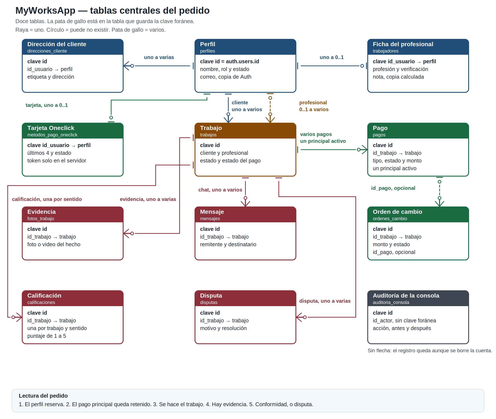

# Análisis de la base de datos de MyWorksApp

MyWorksApp guarda el pedido de un cliente a un profesional: quiénes son, qué se contrató, el dinero retenido hasta la conformidad, la evidencia del trabajo hecho y, si el cliente no está conforme, la disputa.

El 22 de noviembre de 2026, a las 23:04 hora de Chile, el catálogo de PostgreSQL del proyecto Supabase `wxqrfcqifkfgawrnqmnj` respondió esto: **76 tablas** en el esquema `public`, **las 76 con seguridad por filas (RLS)**, **94 claves foráneas** y `app_config.demo_modo = 1`. Este texto explica las doce tablas que sostienen ese pedido. El plano de sesenta tablas en siete colores queda al final, como anexo: en una sola lámina no se lee.

## Cómo leer el diagrama

*Figura. Doce tablas del pedido. La flecha sale de la tabla que guarda la clave foránea.*

Se lee desde **Perfil**, en el centro de arriba. La pata de gallo (el tridente) está en el lado de «varios» y lleva un círculo porque puede no haber ninguna fila. La raya sola es «exactamente uno». La raya con círculo es «cero o uno».

Cuatro relaciones alcanzan para seguir el dinero y el cierre:

1. **Perfil → Trabajo**, dos flechas. La continua es el cliente: todo trabajo tiene uno, y un perfil pide varios. La punteada es el profesional: el trabajo tiene cero o uno, y un perfil atiende varios. El trabajo apunta al perfil, no a la ficha.
2. **Trabajo → Pago.** Varios pagos, y un solo principal activo.
3. **Pago → Orden de cambio**, punteada. Es `id_pago`, opcional. La orden también guarda `id_trabajo`; esa flecha no está dibujada para no cruzar el chat. Está escrita en la caja.
4. **Trabajo → Evidencia**, y después **Calificación** o **Disputa**.

La auditoría no tiene flecha. `id_actor` no es clave foránea: la bitácora queda aunque se borre la cuenta.

Otras claves hacia el perfil (quién escribe el mensaje, quién califica, quién abre la disputa, quién propone la orden) están en el texto de cada caja. Dibujarlas todas devolvería el cruce que este plano evita.

El archivo editable es [`modelo_er_central/er_central.svg`](modelo_er_central/er_central.svg). Se regenera con `python3 gen_er_central.py` en esa carpeta.

## Las doce tablas

### Perfil (`perfiles`)

Es la identidad de la aplicación. La clave `id` (uuid) es la misma de `auth.users`: Auth de Supabase vive fuera de `public`, y si se borra esa cuenta el perfil se borra en cascada.

Guarda nombre, rol y estado de la cuenta. El rol es `usuario` (el cliente), `trabajador`, `administrador`, `soporte` o `qa`. El estado es `activo`, `suspendido`, `bloqueado` o `eliminado`. El correo es una copia del correo de Auth, para buscar sin salir de `public`.

Un perfil tiene **a lo más una** ficha de trabajador, **a lo más una** tarjeta Oneclick y **varias** direcciones. Como cliente pide varios trabajos. Como profesional atiende varios.

### Ficha del profesional (`trabajadores`)

Es la ficha pública del mismo perfil, no una segunda persona. La clave `id_usuario` es a la vez primaria y foránea a `perfiles.id`.

**Un perfil, a lo más un trabajador. Un trabajador es exactamente un perfil.** Un cliente o un administrador no tiene esta fila.

Ahí están la profesión, la comuna, la verificación y los números del catálogo (nota, trabajos completados, puntaje de listado). Esos números salen de las reseñas y de los trabajos terminados, y se guardan en la ficha para ordenar el listado. La migración `20261124050000`, en el repositorio desde el 23 de noviembre, hace que un trigger sea el único que escribe la nota y los trabajos completados. La columna sigue en la tabla.

Oficios, precios, horarios y portafolio no van en esta fila. Cada lista tiene su tabla.

### Dirección del cliente (`direcciones_cliente`)

Direcciones que el cliente guarda en la web, con una etiqueta («Casa», por ejemplo). Clave `id`. `id_usuario` apunta a `perfiles.id` y es obligatoria: si se borra el perfil, se borran sus direcciones.

**Un perfil tiene varias direcciones. Cada dirección es de un solo perfil.**

El trabajo no usa esta clave. El texto del lugar del servicio queda en `trabajos.direccion`.

### Tarjeta Oneclick (`metodos_pago_oneclick`)

La tarjeta inscrita en Transbank Oneclick. La clave es `id_usuario`, foránea a `perfiles.id`. Como la clave es el usuario, **un perfil tiene cero o una tarjeta**.

El token de la tarjeta lo lee el servidor. `anon` y `authenticated` no tienen política sobre esta tabla. `id_trabajo_pendiente` recuerda qué trabajo cobrar cuando termina la inscripción; no es clave foránea. Las columnas de la tarjeta anterior (`tbk_user_prev` y los últimos cuatro dígitos previos) son datos de esta misma fila.

### Trabajo (`trabajos`)

El pedido. Clave `id` (texto).

- `id_usuario` apunta a `perfiles.id` y es obligatorio. **El trabajo tiene exactamente un cliente. El cliente tiene varios trabajos.**
- `id_trabajador` apunta a `perfiles.id` y puede ser nulo. **El trabajo tiene a lo más un profesional**, y no tiene ninguno mientras espera cotización. Si se borra ese perfil, el trabajo queda sin profesional. La ficha se encuentra porque `trabajadores.id_usuario` es ese mismo identificador.
- `estado_pago` copia el estado del pago principal, para listar pedidos sin unir con `pagos`. Lo mantiene un trigger.

El estado del pedido recorre, entre otros, `pendiente`, `esperando_cotizaciones`, `esperando_pago`, `aceptado`, `en_camino`, `en_curso`, `esperando_aprobacion_cliente` y `completado`.

### Pago (`pagos`)

Un cobro del trabajo, retenido (escrow) con Transbank Webpay o Oneclick. Clave `id`. `id_trabajo` es obligatorio.

**Un trabajo tiene varios pagos. Cada pago es de un solo trabajo. Hay un solo pago principal activo.**

Ese «uno» no es la clave primaria. Es el índice único parcial `pagos_un_principal_activo_uidx`: un solo `tipo_pago = principal` en estado `pendiente`, `retenido` o `autorizado` por trabajo. Un principal ya liberado o reembolsado no ocupa ese cupo. Una orden de cambio suma otro pago (`tipo_pago = orden_cambio`) y no reemplaza al principal.

`id_orden_cambio` es opcional y apunta a la orden cuando el cobro es de ella. El estado pasa de `pendiente` a `retenido` cuando Transbank autoriza. `liberado` entrega el dinero al profesional. `reembolsado` lo devuelve al cliente.

### Orden de cambio (`ordenes_cambio`)

Un cambio de alcance o de precio mientras el trabajo está en curso. Clave `id`. `id_trabajo` es obligatorio: **un trabajo tiene varias órdenes y cada orden es de un solo trabajo.** `id_trabajador` apunta al perfil que la propone.

`id_pago` es opcional. El pago puede guardar, a su vez, `id_orden_cambio`. Ninguna de las dos columnas es única, así que la base no obliga a que exista exactamente un pago por orden. Al aceptar la orden, el flujo crea un pago de tipo `orden_cambio` y enlaza las dos filas.

### Evidencia (`fotos_trabajo`)

La foto o el video del trabajo hecho. El archivo está en el depósito privado `evidencias`; la fila guarda la ruta y el tipo (`foto` o video). Clave `id`. `id_trabajo` es obligatorio y, si se borra el trabajo, se borran sus evidencias.

**Un trabajo tiene varias evidencias. Cada evidencia es de un solo trabajo.** Sin al menos una, el profesional no puede declarar el trabajo terminado.

### Mensaje (`mensajes`)

Una línea del chat del trabajo. Clave `id`. `id_trabajo` es obligatorio: **un trabajo tiene varios mensajes y cada mensaje es de un solo trabajo.** `id_remitente` e `id_destinatario` apuntan a perfiles y son obligatorios.

`id_destinatario` repite al otro participante del trabajo. Así el chat y la seguridad por filas filtran sin unir con `trabajos`. En la auditoría del 16 de noviembre esa copia coincidía con su fuente. La migración `20261124050000` deja un trigger como única escritura de esa columna, porque Postgres no puede calcularla con `GENERATED ALWAYS` (hay que leer `trabajos`). La columna no se quitó.

### Calificación (`calificaciones`)

La nota de un trabajo, en un sentido. Clave `id`. `id_trabajo` es obligatorio. El índice único `(id_trabajo, direccion)` admite un solo `cliente_a_trabajador` y un solo `trabajador_a_cliente`.

**Un trabajo tiene a lo más una calificación por sentido.** El puntaje va de 1 a 5. `id_calificado` apunta al perfil que recibe la nota; se guarda para listar reseñas por persona. `id_usuario` es quien califica y puede quedar nulo.

### Disputa (`disputas`)

El reclamo cuando no hay conformidad. Clave `id`. `id_trabajo` es obligatorio: **un trabajo puede tener varias disputas y cada disputa es de un solo trabajo.** `abierta_por` es el perfil que la abre. `resuelta_por` es quien la cierra y puede ser nulo. La resolución libera el pago o lo reembolsa.

### Auditoría de la consola (`auditoria_consola`)

La bitácora de la consola: liberar un pago, resolver una disputa, cambiar un rol y el resto de acciones del tipo `accion_auditoria_consola`. Clave `id` (uuid).

`id_actor` **no tiene clave foránea**. El registro sobrevive a la cuenta. Solo entra por `registrar_auditoria()`; un trigger rechaza el alta, el cambio y el borrado directos. Con RLS la lee un administrador.

## Cómo se lee el flujo

1. **Reserva.** Un perfil cliente crea un trabajo. Puede tener direcciones guardadas, pero el pedido copia el texto en `trabajos.direccion`. Si ya eligió profesional, `id_trabajador` apunta a ese perfil. Si no, el trabajo espera cotizaciones.
2. **Pago retenido.** Se inserta un pago `principal` en estado `pendiente`. Transbank autoriza y el estado pasa a `retenido`: el dinero queda en garantía, no se entrega todavía. Un trigger copia ese estado a `trabajos.estado_pago`. Con Oneclick se usa la fila de `metodos_pago_oneclick`. Sigue habiendo un solo principal activo.
3. **Trabajo.** El profesional acepta, va en camino, el cliente da el PIN de inicio y el trabajo queda `en_curso`. Si cambia el alcance, la orden de cambio genera otro pago. Ese pago no reemplaza al principal.
4. **Evidencia.** El profesional carga fotos o video en `fotos_trabajo`. Sin evidencia no puede terminar. El trabajo pasa a `esperando_aprobacion_cliente`.
5. **Conformidad o disputa.** Si el cliente recibe conforme, el pago retenido se libera y el trabajo queda `completado`. No es un segundo cargo. Si no está conforme, abre una disputa, que termina en liberar o en reembolsar. Si no responde en 48 horas y hay evidencia, el sistema libera el pago. Después, cada parte puede dejar una calificación, una por sentido.

## Forma normal

La auditoría del 16 de noviembre de 2026 leyó el catálogo y clasificó las tablas que existían entonces. El piso de ese conjunto es la **segunda forma normal**. La **mayoría de esas tablas está en BCNF**. La **cuarta forma normal** se declara solo donde el profesional tiene listas independientes, cada una en su tabla: oficios (`trabajador_servicios`), precios (`trabajador_precios`), horarios (`trabajador_horarios` y `trabajador_horas_publicadas`), servicios adicionales (`trabajador_servicios_extra`) y portafolio (`portafolio_trabajador`).

Tres tablas guardaban un dato repetido a propósito. La auditoría del 16 de noviembre las dejó en segunda forma normal, con la copia medida contra su fuente. El 23 de noviembre el repositorio incorporó la migración `20261124050000`. Esto es lo que esa migración hace, y lo que no hace:

| Tabla | Qué había de repetido | Qué hace la migración del 23 de noviembre |
|---|---|---|
| `tickets_soporte` | Nombres y monto en garantía | Si la tabla está vacía, quita `nombre_cliente`, `nombre_trabajador` y `monto_escrow`. La vista `consola_tickets` los lee del trabajo, del perfil y del pago. |
| `mensajes` | `id_destinatario`, el otro participante | La columna sigue. Un trigger es el único que la escribe. |
| `trabajadores` | Nota, trabajos completados y puntaje de listado | Las columnas siguen. Un trigger copia la nota y los trabajos desde la estadística. |

En `tickets_soporte` la repetición sale de la tabla, con la condición de que no haya filas. En `mensajes` y en `trabajadores` la columna sigue, así que la dependencia sigue. Un trigger impide editar la copia a mano. No es una descomposición: por la definición que usó la auditoría del 16 de noviembre, esas dos tablas no quedan en tercera forma normal estricta. La nota del 23 de noviembre en [`normalizacion.md`](normalizacion.md) las llama BCNF porque el trigger es la única escritura. La frase de la defensa, más abajo, no usa esa palabra para ellas.

La lectura del catálogo del 22 de noviembre es anterior a esta migración. No vuelve a contar las 76 tablas.

Quince tablas aparecieron después de la auditoría del 16 de noviembre. Cada una tiene clave de **una columna**. No se declaran en cuarta forma normal. Son: `bloqueos_ip`, `cola_moderacion`, `eventos_acceso`, `ia_banderas`, `ia_cambios_banco`, `ia_cola_embeddings`, `ia_huellas`, `ia_pesos_busqueda`, `ia_resumen_resenas`, `ia_sugerencias_perfil`, `incidentes_seguridad`, `pruebas_seguridad`, `respaldos_consola`, `ticket_mensajes` y `umbrales_seguridad`.

> La mayoría de las tablas que auditamos el 16 de noviembre está en BCNF. La cuarta forma normal la declaramos solo en las listas del profesional: servicios, precios, horarios y portafolio. El 23 de noviembre el repositorio trae una migración sobre las tres tablas que tenían un dato repetido. En tickets de soporte se quitan los nombres y el monto, si la tabla sigue vacía, y se leen del trabajo. En mensajes y en la ficha del profesional la columna repetida sigue: un trigger es el único que la escribe. Eso no borra la dependencia, así que no digo que todo el esquema esté en tercera forma normal. Las quince tablas nuevas tienen clave de una columna y no las declaro en cuarta forma normal.

El detalle del criterio está en [`normalizacion.md`](normalizacion.md) y en [`pruebas/auditoria_base_datos.md`](pruebas/auditoria_base_datos.md). Este texto no los reemplaza.

## Seguridad por filas y modo demostración

RLS está activo en las **76** tablas de `public` medidas el 22 de noviembre de 2026. El detalle de políticas, tabla por tabla, no se volvió a contar ese día: el número viejo (132 políticas sobre 60 tablas) no se extrapola.

`app_config.demo_modo` seguía en **1**. Con ese valor, las cuentas marcadas `trabajadores.es_demo` siguen en el catálogo, con el aviso de datos de demostración. Con otro valor se ocultan y no se pueden reservar ni cobrar.

## Anexo: el mapa que no cabe en una lámina

El dibujo de siete colores es el mapa de dominios de **60 tablas**, no el detalle de cada clave. Se conserva. No se reemplaza por este análisis.

- Mapa de dominios (60 tablas): [`modelo_er60/figuras/er60_00_mapa_dominios.png`](modelo_er60/figuras/er60_00_mapa_dominios.png).
- El mismo corte, un dominio por figura, con columnas y cardinalidad: carpeta [`modelo_er60/figuras/`](modelo_er60/figuras/).
- El corte anterior, de 57 tablas (17 de noviembre de 2026): [`Fase 2/modelo_entidad_relacion/`](../../Fase%202/modelo_entidad_relacion/LEEME.txt) y su mapa [`er_00_dominios.png`](../../Fase%202/modelo_entidad_relacion/figuras/er_00_dominios.png).
- Columnas, tipos y claves, una por una: [`DICCIONARIO_BASE_DATOS.md`](DICCIONARIO_BASE_DATOS.md). La sección 0-bis anota la lectura del 22 de noviembre y las quince tablas nuevas.
