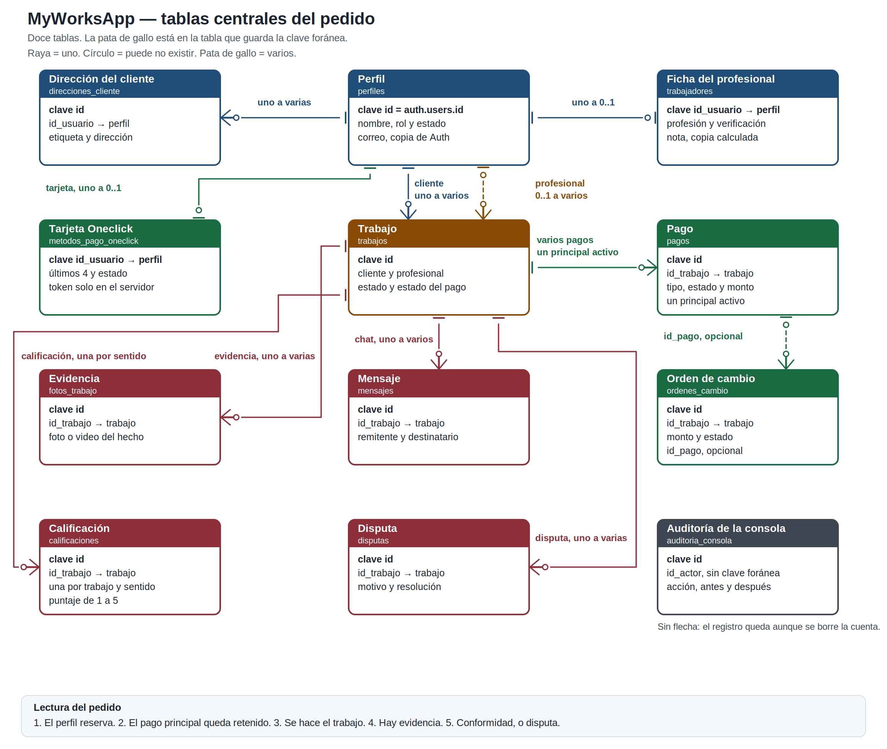

# Modelo entidad-relación

> **Esquema documentado: 60 tablas en `public`, con RLS en las 60.** Las migraciones del 20-11-2026 agregaron `auditoria_consola`, `rate_limit_ventana` y `direcciones_cliente` a las 57 del snapshot, y las tres habilitan RLS (detalle en la sección 0 de [`DICCIONARIO_BASE_DATOS.md`](DICCIONARIO_BASE_DATOS.md)). Las figuras del informe están en [`modelo_er60/`](modelo_er60/).
>
> El modelo que se explica en la defensa es el central de 12 tablas, dentro de esas 60. El SQL para MySQL Workbench está en [`modelo_er_central_workbench.sql`](../../Fase%202/modelo_entidad_relacion/modelo_er_central_workbench.sql). El diagrama está en [`modelo_er_central/er_central.png`](modelo_er_central/er_central.png).

El modelo ER del snapshot (57 tablas, 85 claves foráneas, migración `20261117223850`) está en
[`Fase 2/modelo_entidad_relacion/`](../../Fase%202/modelo_entidad_relacion/LEEME.txt):

- `figuras/er_00_dominios`: mapa de los 7 dominios.
- `figuras/er_00_general`: las 57 tablas con su PK y todas las FK.
- `figuras/er_01` a `er_07`: un diagrama por dominio con columnas, tipos, PK/FK y cardinalidad.
- `modelo_er.dbml` (dbdiagram.io), `modelo_er_postgres.sql`, `modelo_er_mysql_workbench.sql` y `fuentes/*.dot`.
- `modelo_er_central_workbench.sql`: las 12 tablas centrales, para MySQL Workbench. El esquema documentado que las contiene tiene 60 tablas, con RLS en las 60.
- `LEEME.txt` explica la notación, los dominios, las relaciones lógicas sin FK y cómo regenerar todo.

La explicación de cada dominio, el flujo de pago y escrow y las decisiones de diseño están en la
sección 2b de [`DICCIONARIO_BASE_DATOS.md`](DICCIONARIO_BASE_DATOS.md) (3b en el `.docx`).

